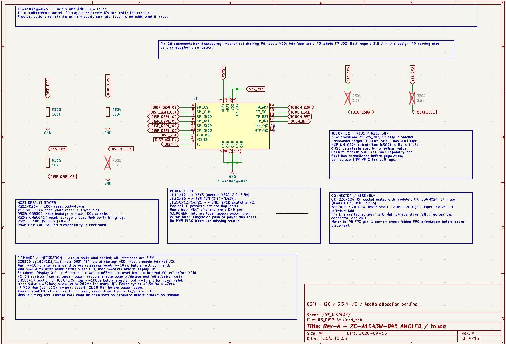
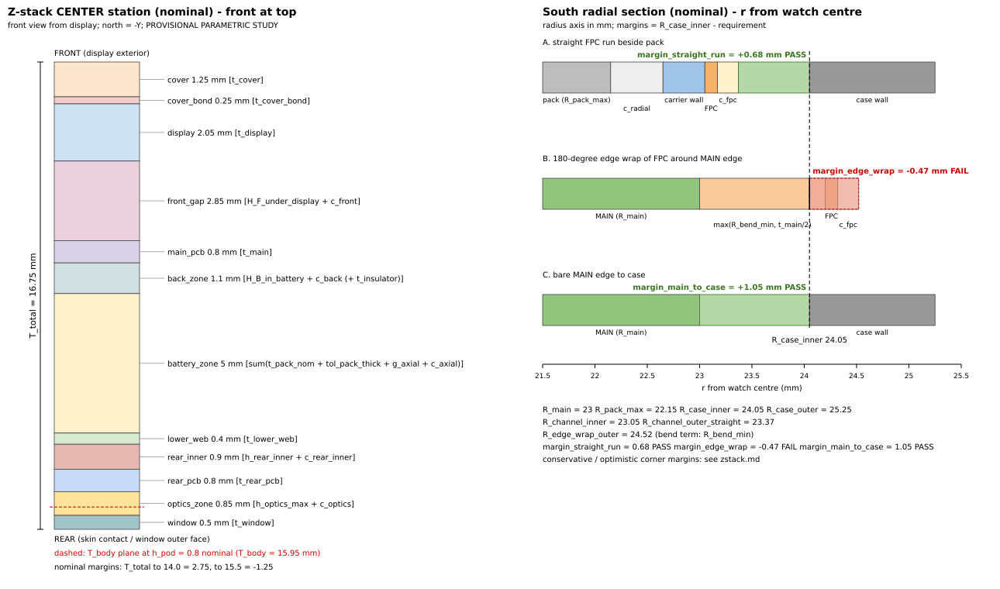
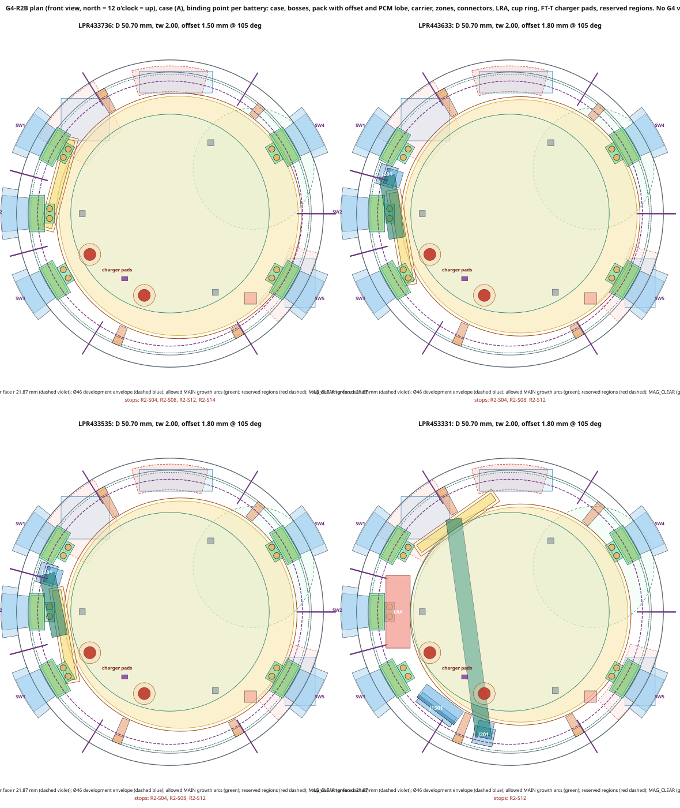

# Sköll Ultra

**An open, from-scratch outdoor and endurance smartwatch: custom electronics, PCB design, mechanical packaging and, later, embedded firmware.**

In Norse mythology, Sköll is the wolf who chases the sun across the sky, never stopping. His twin brother Hati chases the moon. The name fits a watch built for long days outside: the design target is **30 hours of GNSS tracking with heart rate**, enough for an ultramarathon from sunrise to well past sunset.

This is a personal engineering project. I design the system at component and PCB level instead of building on a ready-made smartwatch module, and I own every engineering decision: architecture, part selection, power budget, mechanical packaging and verification.

> **Current phase:** Rev-A hardware. Schematics for both boards are drafted in KiCad. The mechanical package (case, battery, haptics, buttons) is being closed before PCB layout. Firmware starts at hardware bring-up.

---

## Design targets

| | Rev-A target |
|---|---|
| Case | Round, 51 mm, titanium caseback, CNC midcase |
| Thickness | ≤ 16.5 mm nominal |
| Battery life | ≥ 30 h with GPS + Galileo at 1 Hz and optical heart rate |
| Display | 1.43" round AMOLED with touch |
| Buttons | 5 mechanical pushers |
| Charging | Two-pin contacts through the caseback, inside the seal |

Rev-A is a working prototype, not a product. It is allowed to be thicker than a commercial watch; Rev-B can shrink it once Rev-A is proven.

---

## Hardware architecture

Two boards: **MAIN** (processor, radios, display, power, motion sensors) and **REAR** (optical heart rate and skin temperature against the wrist), connected by a 24-position FPC.

| Subsystem | Part |
|---|---|
| Application processor + BLE | Ambiq Apollo510B |
| Power management + charger | Nordic nPM1300 |
| GNSS (L1 + L5) | u-blox MAX-F10S |
| Wi-Fi 6 | Nordic nRF7002 |
| Display | ZC-A1D43W-046, 1.43" AMOLED (CO5300 driver, CHSC6417 touch) |
| Storage | Kingston eMMC |
| IMU | ST LSM6DSV16X |
| Magnetometer | Bosch BMM350 |
| Barometer | Bosch BMP585 |
| Ambient light | TI OPT4001 |
| Haptics | TI DRV2625 + Vybronics VLV041035L LRA |
| Optical heart rate (REAR) | 2 x MAX86141, OSRAM SFH 7018A emitter, SFH 2703 photodiodes |
| Skin temperature (REAR) | MAX30208 |

### Display subsystem

Schematic excerpt of the display interface: QSPI, I²C touch controller, power rails and reset/enable circuitry.

<p align="center">
  
</p>

---

## Mechanical packaging

A watch is a packaging problem first. Before PCB layout, I built a parametric model of the whole stack (display, MAIN board, battery, REAR board, caseback) to check that everything fits with real tolerances, battery swelling and assembly clearances.

<p align="center">
  
</p>

<p align="center">
  
</p>

Some of the decisions this forced:

- **Battery.** 540 mAh is the minimum for the 30 h target. The candidate cells are "round" LiPo packs that turn out to be D-shaped: the part number encodes thickness, diameter and the height across a flat edge. Placing that flat next to the haptic motor is what may make the package close at 51 mm.
- **Haptics.** A coin vibration motor does not fit around a 36 mm battery, so the design uses a slim bar-type LRA beside the battery, on spring contacts.
- **Buttons.** The switches sit on small case-mounted boards with spring contacts to the MAIN board, instead of being soldered to it. This keeps the button forces off the main PCB.
- **Antennas.** Each radio has its own sector of the case edge: GNSS at 12 o'clock, BLE at 10 to 11, Wi-Fi at 3:30 to 4:30.

### Power budget

| Battery | Estimated GNSS workout time |
|---|---|
| 425 mAh | ~23 h |
| 475 mAh | ~26 h |
| **540 mAh** | **~30 h** |
| 585 mAh | ~32 h |

Estimates for GPS + Galileo at 1 Hz with heart rate, at room temperature. Cold reduces usable capacity.

---

## Repository layout

```text
├── sportwatch_revA.kicad_pro / .kicad_sch / .kicad_pcb   MAIN board
├── 01_APOLLO510B ... 14_RF.kicad_sch                     MAIN hierarchical sheets
├── rear_sensor/                                         REAR board (PPG + skin temperature)
├── libraries/                                           custom symbols and footprints
├── design/mechanical/generated/                         packaging drawings
├── design/placement/                                    MAIN placement plan
└── images/
```

Custom symbols and footprints are kept with the project, so it opens on any machine with KiCad.

---

## Status

### Hardware

- [x] System architecture and part selection
- [x] Schematics drafted for all MAIN subsystems and the REAR board
- [x] Custom symbols and footprints
- [x] Board-to-board interface defined (24-position FPC, all pins assigned)
- [x] Mechanical stack model and case architecture
- [ ] Battery selection (waiting for supplier drawings)
- [ ] Schematic verification pass against datasheets
- [ ] MAIN and REAR placement and routing
- [ ] RF layout review, DRC and manufacturing review
- [ ] Bench tests: haptic spring contacts, magnetometer offset from the haptic magnet
- [ ] Prototype fabrication and bring-up

### Firmware (after bring-up)

Board support and drivers, power management, display and UI, GNSS, heart rate processing, activity recording, storage, BLE and Wi-Fi sync, and a test and diagnostics toolset.

---

## How I work

I make the engineering decisions and own the result: requirements, architecture, part selection, trade-offs and sign-off. For implementation work such as packaging scripts and schematic edits, I use AI coding assistants under written specifications, with a fixed rule that no tool reviews its own output. Every result is checked by an independent review and against manufacturer datasheets before it is accepted.

---

## License

TBD.
